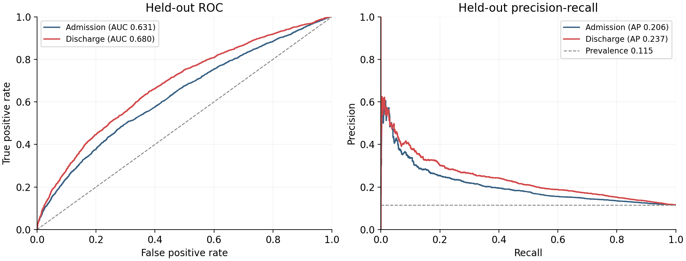

# Discharge-Time Information and 30-Day Readmission: Reproduction

Reproduction of Bhuvan Rajpoot, *Does Discharge-Time Information Improve 30-Day Readmission Prediction? A Patient-Disjoint Evaluation in the UCI Diabetes 130-US Hospitals Cohort* (2026). [Paper](https://ssrn.com/abstract=7154739).

The experiment compares 10 admission-time predictors with 46 discharge-time predictors using patient-disjoint development and test sets. Implementation details absent from the paper are documented in [method assumptions](ASSUMPTIONS_AND_PAPER_ISSUES.md). A detailed [report in Traditional Chinese](REPRODUCTION_REPORT_zh-TW.md) covers results and discrepancies.

## Results

| Selected pipeline | Paper AUROC | Reproduction AUROC | Paper AP | Reproduction AP |
|---|---:|---:|---:|---:|
| Admission / Logistic Regression | 0.631 | 0.6308 | 0.206 | 0.2058 |
| Discharge / Histogram Gradient Boosting | 0.677 | 0.6800 | 0.237 | 0.2374 |

The AUROC gain is 0.0492 (95% CI 0.0393–0.0595), the AP gain is 0.0316 (0.0224–0.0418), and the Brier difference is −0.00228 (−0.00288 to −0.00174), using 500 paired patient-cluster bootstrap samples.

The selected models agree with the paper. Two notable discrepancies remain: discharge logistic regression has AUROC 0.6643 versus 0.649, and the admission F2 operating point alerts on 81.95% of encounters versus 74.8%.



## Reproduce

The reference environment uses Python 3.12.7 and scikit-learn 1.5.1. Package versions are pinned in `requirements.txt`.

```powershell
conda env create -f environment.yml
conda run -n rajpoot-readmission python scripts/download_data.py
conda run -n rajpoot-readmission python -m pytest -q
conda run --no-capture-output -n rajpoot-readmission python reproduce.py
conda run -n rajpoot-readmission python scripts/verify_results.py
```

`python reproduce.py --quick` checks the workflow on 3,000 patients with 20 boosting iterations and 20 bootstrap samples; its outputs go to `results/smoke/`. Full runs write to `results/full/` and overwrite previous outputs. Use `--output` to retain a separate run; see `python reproduce.py --help` for other options.

## Data and methods

Data: [UCI Diabetes 130-US Hospitals for Years 1999-2008](https://archive.ics.uci.edu/dataset/296/diabetes-130-us-hospitals-for-years-1999-2008). The source CSV is checked against the SHA-256 published in the paper. After the reported exclusions, the cohort contains 99,340 encounters from 69,987 patients. The test set contains 19,942 encounters from 13,998 patients. Data attribution, checksum and preprocessing rules are listed in [data/README.md](data/README.md).

- Patients are assigned to an 80/20 development/test split (seed 2026). Development uses three-fold stratified group validation (seed 2027).
- L2 logistic regression and histogram gradient boosting are evaluated for each predictor set. Imputation and encoding are fitted within each training fold.
- Models are selected by development out-of-fold AP, with Brier score breaking ties. F1/F2 thresholds are also selected from development predictions.
- Test evaluation includes discrimination, calibration, operating characteristics and descriptive subgroup results. Confidence intervals use paired patient-cluster bootstrap samples.

## Files

| Path | Purpose |
|---|---|
| `configs/paper.json` | Model parameters and implementation settings |
| `src/readmission/` | Data processing, models, evaluation and reporting |
| `tests/` | Tests for data integrity, patient separation, preprocessing and inference |
| `scripts/verify_results.py` | Verification of saved predictions, metrics and hashes |
| `results/full/tables/` | Candidate metrics, paper comparisons, thresholds, bootstrap and subgroup results |
| `results/full/predictions/` | Development OOF and test predictions for all four candidates |
| `results/full/splits/` | Exclusion audit and patient-disjoint assignments |
| `results/full/figures/` | ROC/PR, calibration and confidence-interval plots |
| `results/full/runtime.json` | Environment, configuration and source/code hashes |

Raw data and fitted models are excluded from Git and regenerated by the reproduction pipeline. Each run also writes a report and records development-only model and threshold choices in `selection_lock.json` before test evaluation.

## License

Code and documentation: MIT. Manuscript and dataset: CC BY 4.0; see [LICENSE](LICENSE) and [data attribution](data/README.md).
