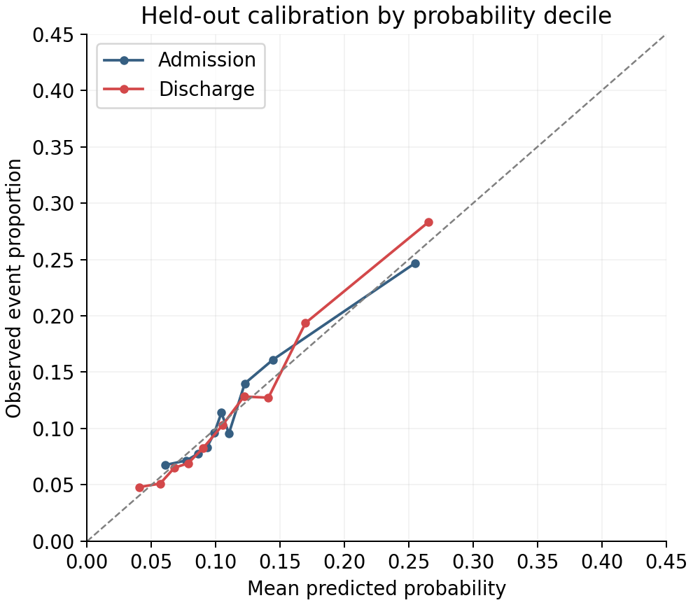

# Rajpoot 論文獨立復現：結果與解讀

本專案已完成原始資料下載與雜湊核對、完整開發與測試流程、四個候選模型，以及 500 次病人層級配對 bootstrap。主要結論是：**出院資訊帶來有限但明確的改善；主要選定模型的表現接近論文，但仍有未完整重現的候選模型與操作閾值結果。**

依據為使用者提供的 `docs/ssrn-7154739.pdf`（Rajpoot，2026-07-21，SSRN 7154739）。作者在第 5 頁表示已準備 reproducibility package，但本版本未提供永久 URL/DOI。因此本專案依文字與表格重新實作，不宣稱使用作者原始程式。

## 兩篇論文是否使用同一資料集？

是。[UCI Diabetes 130-US Hospitals for Years 1999-2008](https://archive.ics.uci.edu/dataset/296/diabetes-130-us-hospitals-for-years-1999-2008) 是共同來源；Salim & Ibrahim 也是目標論文的參考文獻 [5]。但範例 repo 的 encounter-level nested CV、特徵工程與模型不同，不能直接搬用其模型分數作為這篇的復現結果。

本次讀取的原始 CSV SHA-256 為：

```text
0689e7ec031237dc63031b938805c48377748761a3b26acab621567afa24df97
```

與論文第 2 頁完全一致。UCI 原始資料為 101,766 筆。

## 樣本與切分

| 項目 | 論文 | 本次 |
|---|---:|---:|
| 合格住院紀錄 | 99,340 | 99,340 |
| 合格病人 | 69,987 | 69,987 |
| 30 日內再入院陽性 | 11,314 | 11,314 |
| 開發集紀錄／病人 | 79,398／55,989 | 79,398／55,989 |
| 測試集紀錄／病人 | 19,942／13,998 | 19,942／13,998 |
| 測試集盛行率 | 11.52% | 11.5184% |

使用 seed 2026 的 `GroupShuffleSplit`，以及開發集 seed 2027 的三折 `StratifiedGroupKFold`。檢查確認所有評估邊界皆無病人重疊；每筆開發紀錄恰有一次 OOF 預測。沒有作者的原始 split 檔，故數量一致仍不能證明每一位病人的分區都一致。

## 四個候選模型

| 特徵／模型 | 論文 Dev AP | 本次 Dev AP | 論文 Test AUROC | 本次 Test AUROC | 論文 Test AP | 本次 Test AP |
|---|---:|---:|---:|---:|---:|---:|
| 入院／Logistic（選出） | 0.194 | 0.1925 | 0.631 | 0.6308 | 0.206 | 0.2058 |
| 入院／Histogram Boosting | 0.190 | 0.1883 | 0.633 | 0.6328 | 0.206 | 0.2057 |
| 出院／Logistic | 0.200 | 0.2107 | 0.649 | 0.6643 | 0.213 | 0.2272 |
| 出院／Histogram Boosting（選出） | 0.220 | 0.2209 | 0.677 | 0.6800 | 0.237 | 0.2374 |

開發集的選擇與論文一致。入院模型的測試指標相當接近；出院 boosting 的 AUROC 比論文高約 0.003，但 AP 很接近。**出院 logistic 的 AUROC 高出約 0.0153，AP 高出約 0.0142，是明顯未完全重現的候選模型。**

論文未提供 ICD-9 分組完整對照、類別處理細節與精確 scikit-learn 版本。這些設定可能影響結果，但目前無法把差異歸因於其中任何一項；本次沒有利用測試分數搜尋可配合論文的設定。

## 主要配對比較

以下比較由開發集選出的兩個完整 pipeline；兩者模型家族不同，因此不是固定同一算法下的純特徵增量實驗。所有差異為「出院減入院」。

| 指標 | 論文差異（95% CI） | 本次差異（95% CI） |
|---|---|---|
| AUROC | 0.046 [0.036, 0.056] | 0.04919 [0.03926, 0.05948] |
| Average precision | 0.032 [0.020, 0.042] | 0.03161 [0.02241, 0.04177] |
| Brier | −0.0022 [−0.0028, −0.0016] | −0.00228 [−0.00288, −0.00174] |

本次以相同病人抽樣同時計算兩模型，重複抽中的病人保留所有住院紀錄，使用 500 次 percentile bootstrap。AUROC 與 AP 的差異區間皆大於零，Brier 差異皆小於零，支持論文的主要方向性結論。這些區間條件於固定模型預測，不包含重新訓練的不確定性。

## 操作閾值與校準的差異

| F2 操作點 | 論文閾值 | 本次閾值 | 論文敏感度 | 本次敏感度 | 論文特異度 | 本次特異度 | 論文警示比例 | 本次警示比例 |
|---|---:|---:|---:|---:|---:|---:|---:|---:|
| 入院／Logistic | 0.087 | 0.08039 | 0.844 | 0.8920 | 0.264 | 0.1900 | 74.8% | 81.95% |
| 出院／Boosting | 0.084 | 0.08310 | 0.789 | 0.8006 | 0.422 | 0.4180 | 60.2% | 60.72% |

入院 F2 閾值與警示比例未完全重現。即使 AUROC 接近，開發集 OOF 預測與 F2 目標的小變化仍可能改變最佳閾值；本次沒有使用測試集修正閾值。

入院模型 Brier 為 0.098780（論文 0.0988），校準截距／斜率為 −0.1778／0.9097（論文 −0.173／0.913）。出院模型 Brier 為 0.096505（論文 0.0966），截距／斜率為 0.1479／1.0691（論文 0.103／1.046）。校準參數以未懲罰的聯合截距／斜率回歸計算，不對預測做後校準。

出院模型 F2 的 PPV 僅 15.19%，仍會對超過六成住院紀錄發出警示。主要比較的改善不能直接解讀成臨床部署效益。

## 實作、驗證與輸出

完整參數與所有未公開設定的選擇見 [方法假設](ASSUMPTIONS_AND_PAPER_ISSUES.md)；執行方式見 [README](README.md)。

- 九個測試檢查 checksum、防止病人洩漏、保留 `None` 類別、訓練折限定前處理、OOF 選模與閾值，以及 cluster bootstrap 與明確複製病人的等價性。
- `scripts/verify_results.py` 另從儲存的模型重算測試預測與全部指標，核對 OOF 決策、病人邊界、程式碼雜湊，以及 500 次配對差異與區間。
- `results/full/runtime.json` 保留 Python 3.12.7、scikit-learn 1.5.1 等版本、參數與雜湊。初次完整執行約 82 秒、四執行緒，未修改共用 Python 環境。
- `results/full/selection_lock.json` 在測試評估前記錄開發集選擇、F1/F2 閾值與 OOF 雜湊；這是本次執行的紀錄，不是作者原始 protocol 或事先註冊。

逐項數值見 [候選模型對照 CSV](results/full/tables/paper_vs_reproduction.csv)、[閾值對照 CSV](results/full/tables/thresholds_vs_paper.csv) 與 [自動生成完整報告](results/full/REPRODUCTION_REPORT_zh-TW.md)。原始資料與四個模型均保留本機；Git 忽略它們，重跑可重新產生。





這份報告記錄初次完整實驗；後續重跑會更新指定輸出目錄中的自動報告。資料來自 1999–2008 年，這是病人互斥的內部驗證，不能取代時間、外部或前瞻驗證。
