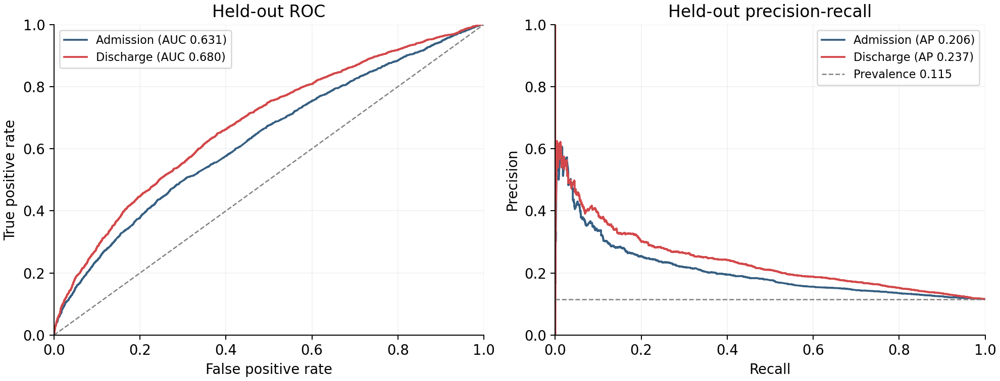
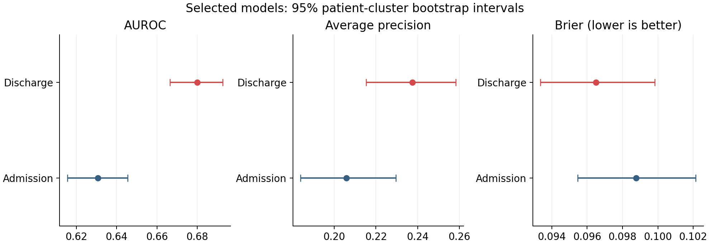

# Rajpoot（2026）復現報告

本報告復現 Rajpoot 的 [*Does Discharge-Time Information Improve 30-Day Readmission Prediction?*](https://ssrn.com/abstract=7154739)，比較入院與出院特徵在病人互斥測試集上的預測表現。方法依論文第 3 節實作，結果與 Tables 1–3 對照；論文未交代的設定列於 [方法假設](ASSUMPTIONS_AND_PAPER_ISSUES.md)。

## 資料與切分

資料來自 [UCI Diabetes 130-US Hospitals for Years 1999-2008](https://archive.ics.uci.edu/dataset/296/diabetes-130-us-hospitals-for-years-1999-2008)，共 101,766 筆住院紀錄。原始 CSV 的 SHA-256 與論文一致：

```text
0689e7ec031237dc63031b938805c48377748761a3b26acab621567afa24df97
```

| 項目 | 論文 | 本次 |
|---|---:|---:|
| 合格住院紀錄 | 99,340 | 99,340 |
| 合格病人 | 69,987 | 69,987 |
| 30 日內再入院陽性 | 11,314 | 11,314 |
| 開發集紀錄／病人 | 79,398／55,989 | 79,398／55,989 |
| 測試集紀錄／病人 | 19,942／13,998 | 19,942／13,998 |
| 測試集盛行率 | 11.52% | 11.5184% |

使用 seed 2026 的 `GroupShuffleSplit`，以及開發集 seed 2027 的三折 `StratifiedGroupKFold`。各評估邊界均無病人重疊，每筆開發紀錄有一次 out-of-fold（OOF）預測。樣本數與論文一致，但缺少作者的切分檔，無法逐一核對病人分區。

## 四個候選模型

| 特徵／模型 | 論文 Dev AP | 本次 Dev AP | 論文 Test AUROC | 本次 Test AUROC | 論文 Test AP | 本次 Test AP |
|---|---:|---:|---:|---:|---:|---:|
| 入院／Logistic（選出） | 0.194 | 0.1925 | 0.631 | 0.6308 | 0.206 | 0.2058 |
| 入院／Histogram Boosting | 0.190 | 0.1883 | 0.633 | 0.6328 | 0.206 | 0.2057 |
| 出院／Logistic | 0.200 | 0.2107 | 0.649 | 0.6643 | 0.213 | 0.2272 |
| 出院／Histogram Boosting（選出） | 0.220 | 0.2209 | 0.677 | 0.6800 | 0.237 | 0.2374 |

依開發集 OOF AP 選出的模型與論文相同：入院採 logistic regression，出院採 histogram gradient boosting。入院模型的測試指標接近論文；出院 boosting 的 AUROC 高約 0.003，AP 相近。出院 logistic 的差異較大，AUROC 高約 0.0153，AP 高約 0.0142。

論文未提供完整 ICD-9 分組表、部分類別處理細節及 scikit-learn 版本。目前無法判定這些設定對差異的個別影響；設定未依測試集表現調整。

## 主要配對比較

以下比較開發集選出的兩個模型，差異定義為「出院減入院」。由於兩者採用不同模型家族，差異同時包含特徵與模型選擇的影響。

| 指標 | 論文差異（95% CI） | 本次差異（95% CI） |
|---|---|---|
| AUROC | 0.046 [0.036, 0.056] | 0.04919 [0.03926, 0.05948] |
| Average precision | 0.032 [0.020, 0.042] | 0.03161 [0.02241, 0.04177] |
| Brier | −0.0022 [−0.0028, −0.0016] | −0.00228 [−0.00288, −0.00174] |

500 次 bootstrap 以病人為抽樣單位，保留其全部住院紀錄，兩模型共用每次抽樣。AUROC 與 AP 的差異區間皆大於零，Brier 差異區間小於零，與論文的改善方向一致。區間以固定模型預測計算，不包含重新訓練的不確定性。

## 操作閾值與校準的差異

| F2 操作點 | 論文閾值 | 本次閾值 | 論文敏感度 | 本次敏感度 | 論文特異度 | 本次特異度 | 論文警示比例 | 本次警示比例 |
|---|---:|---:|---:|---:|---:|---:|---:|---:|
| 入院／Logistic | 0.087 | 0.08039 | 0.844 | 0.8920 | 0.264 | 0.1900 | 74.8% | 81.95% |
| 出院／Boosting | 0.084 | 0.08310 | 0.789 | 0.8006 | 0.422 | 0.4180 | 60.2% | 60.72% |

入院 F2 閾值與警示比例的差異較大。最佳閾值取決於開發集 OOF 預測，因此 AUROC 接近並不保證閾值相同。測試集僅用於評估，未用於修正閾值。

入院模型 Brier 為 0.098780（論文 0.0988），校準截距／斜率為 −0.1778／0.9097（論文 −0.173／0.913）。出院模型 Brier 為 0.096505（論文 0.0966），截距／斜率為 0.1479／1.0691（論文 0.103／1.046）。校準參數以未懲罰的聯合截距／斜率回歸計算，不對預測做後校準。

出院模型在 F2 閾值下的 PPV 為 15.19%，警示比例為 60.72%。此操作點的警示負擔仍高，預測表現的改善尚不足以證明臨床效益。

## 驗證與輸出

執行方式見 [README](README.md)。

- 九個測試涵蓋資料完整性、病人互斥、缺失值處理、折內前處理、OOF 選模與閾值，以及病人層級 bootstrap 的計算，均已通過。
- `scripts/verify_results.py` 從儲存模型重算測試預測與指標，核對 OOF 決策、病人邊界、程式碼雜湊，以及 500 次配對差異與區間。
- `results/full/runtime.json` 記錄環境版本、參數與雜湊；`selection_lock.json` 記錄測試評估前選定的模型與 F1/F2 閾值。

逐項數值見 [候選模型對照 CSV](results/full/tables/paper_vs_reproduction.csv)、[閾值對照 CSV](results/full/tables/thresholds_vs_paper.csv) 與 [執行結果](results/full/REPRODUCTION_REPORT_zh-TW.md)。






## 限制

資料來自 1999–2008 年，評估限於同一資料來源的病人互斥內部驗證。入院特徵的可用時間依欄位語意推定；診斷映射、部分類別處理及軟體版本也需另作實作選擇。這些結果仍需時間、外部與前瞻驗證。
