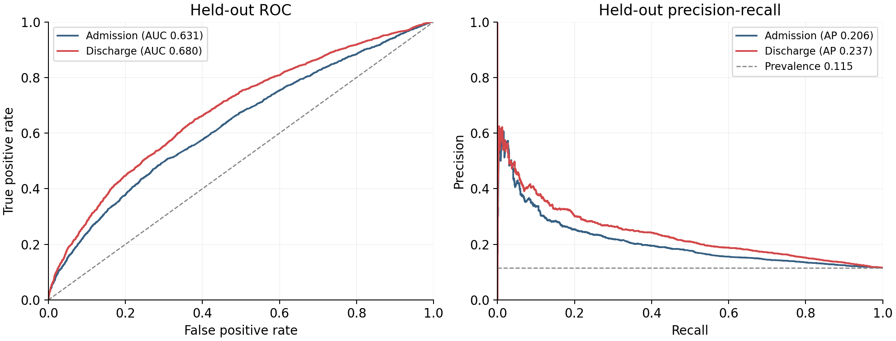
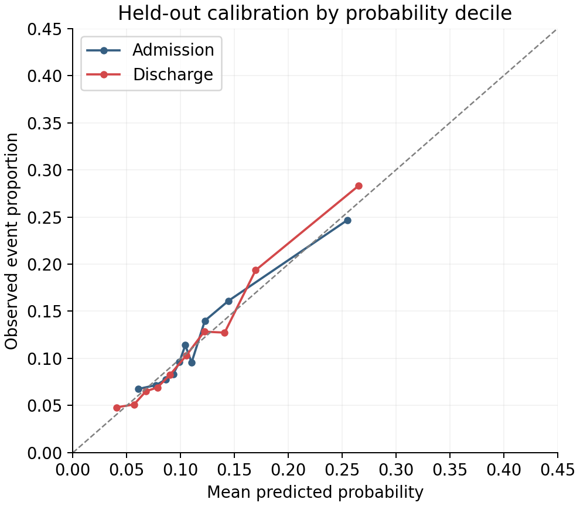
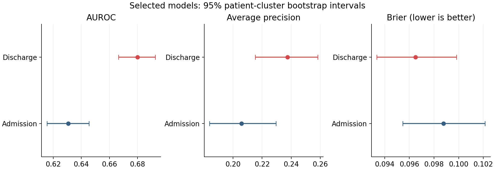

# Rajpoot (SSRN 7154739) 獨立復現結果

這是依論文文字重建的方法，不是作者未公開程式碼的精確重跑。
執行時間（UTC）：2026-11-17T11:33:46.187174+00:00；模式：完整資料、完整模型與 500 次病人 bootstrap。

## 資料與切分

來源 CSV SHA-256：`0689e7ec031237dc63031b938805c48377748761a3b26acab621567afa24df97`，與論文一致。
病人互斥檢查已通過；開發集每筆紀錄恰好有一次 OOF 預測。

| 分區 | 住院紀錄 | 病人 | 陽性 | 盛行率 |
|---|---:|---:|---:|---:|
| eligible | 99,340 | 69,987 | 11,314 | 11.3892% |
| development | 79,398 | 55,989 | 9,017 | 11.3567% |
| test | 19,942 | 13,998 | 2,297 | 11.5184% |

## 模型選擇及測試表現

模型由開發集 OOF AP 最大者選出，Brier 最低者打破平手；選擇與 F1/F2 閾值在測試評估前寫入 `selection_lock.json`。

| 特徵 | 模型 | 選出 | Dev AP | Test AUROC | Test AP | Brier | 校準截距 | 校準斜率 |
|---|---|---|---:|---:|---:|---:|---:|---:|
| admission | logistic | 是 | 0.1925 | 0.6308 | 0.2058 | 0.09878 | -0.178 | 0.910 |
| admission | hgb |  | 0.1883 | 0.6328 | 0.2057 | 0.09855 | -0.103 | 0.940 |
| discharge | logistic |  | 0.2107 | 0.6643 | 0.2272 | 0.09732 | -0.115 | 0.937 |
| discharge | hgb | 是 | 0.2209 | 0.6800 | 0.2374 | 0.09650 | 0.148 | 1.069 |

## 入院與出院資訊的配對差異

以下一律為出院減入院；兩模型使用相同的病人 bootstrap 抽樣，並保留被抽中病人的全部住院紀錄。

| 指標 | 差異 | 95% 百分位區間 | 論文差異 |
|---|---:|---|---:|
| auroc | 0.04919 | [0.03926, 0.05948] | 0.0460 |
| ap | 0.03161 | [0.02241, 0.04177] | 0.0320 |
| brier | -0.00228 | [-0.00288, -0.00174] | -0.0022 |

## 開發集選定的操作閾值

| 特徵 | 準則 | 閾值 | 敏感度 | 特異度 | PPV | NPV | F1 | F2 | 警示比例 |
|---|---|---:|---:|---:|---:|---:|---:|---:|---:|
| admission | F1 | 0.12038 | 0.423 | 0.765 | 0.190 | 0.911 | 0.262 | 0.340 | 25.7% |
| admission | F2 | 0.08039 | 0.892 | 0.190 | 0.125 | 0.931 | 0.220 | 0.401 | 81.9% |
| discharge | F1 | 0.13611 | 0.496 | 0.758 | 0.210 | 0.920 | 0.295 | 0.390 | 27.2% |
| discharge | F2 | 0.08310 | 0.801 | 0.418 | 0.152 | 0.942 | 0.255 | 0.432 | 60.7% |

## 與論文的一致程度

本次入院 AUROC 為 0.6308（論文 0.631），出院為 0.6800（論文 0.677）。
配對 AUROC 差異為 0.0492，AP 差異為 0.0316。
AUROC 與 AP 差異的區間皆大於零，支持論文『出院資訊提供有限但明確的改善』的方向性結論。
選出的模型為入院 logistic、出院 hgb；論文為 logistic、hgb。
每個候選模型的逐項誤差見 `tables/paper_vs_reproduction.csv`；閾值與區間也有對照表。
不能把接近的數值當作已找回作者實作。未公開的診斷映射、類別處理與版本可能影響差異，且本次未依測試結果搜尋這些選擇。

## 圖與可稽核輸出

- `predictions/development_oof.csv.gz`：四個候選模型的 OOF 預測。
- `predictions/test_predictions.csv.gz`：四個候選模型的測試預測。
- `splits/encounter_assignments.csv.gz`：原始列、病人、分區與 CV 折。
- `tables/bootstrap_replicates.csv.gz`：每次配對抽樣的指標與差異。
- `tables/subgroups.csv`：至少 200 筆且包含兩類結果的性別／種族描述性分析。
- `runtime.json`：參數、環境、原始資料與程式碼雜湊。
- `models/`：四個訓練完成的前處理與模型 pipeline（僅載入可信任的 joblib 檔）。

## 限制

這是同一歷史資料來源的內部驗證；bootstrap 只估計固定預測下的病人抽樣不確定性，不涵蓋重新訓練、跨院或時間漂移。
入院特徵可用性依欄位語意近似。族群分析是描述性結果，不構成公平性認證。
完整方法假設與範例 repo 的差異見專案根目錄 `ASSUMPTIONS_AND_PAPER_ISSUES.md`。
